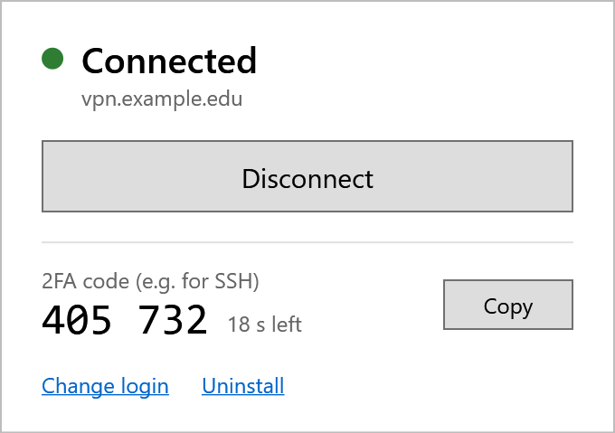

# Cisco VPN Auto-Login

**Stop typing your password and 2FA code every time you connect to your Cisco VPN.**

If your VPN login means opening Cisco Secure Client, typing your password, unlocking your phone
and copying a 6-digit code from your authenticator app, this does all of it for you.
Set it up once, then **connect with one click**.

| Before | After |
| --- | --- |
| Open Cisco, click Connect, type password, find phone, open authenticator app, type code, click OK | Open **Cisco VPN**, click **Connect** |



One small window shows whether you're connected, connects and disconnects with one button, and
shows your current 2FA code with a Copy button (handy for SSH logins that ask for it).

Works on **Windows** with **Cisco Secure Client** or **AnyConnect**, for VPNs that ask for a password
plus a 6-digit code from an authenticator app (Google Authenticator, Duo Mobile, Microsoft
Authenticator, ...). Not for browser/SSO logins or Duo **push**.

## Install (2 minutes, no commands to type)

1. **Find your 2FA secret key.** This is not the 6-digit code. It's the key your authenticator
   app was set up with: a string of 16 or more letters and digits. Your VPN's 2FA setup page
   usually shows it as text ("can't scan the QR code?"). Otherwise, the QR code contains an
   `otpauth://...secret=...` link, and you can paste that instead.
2. **[Download the zip](https://github.com/jiahaozhang2025/cisco-vpn-autologin/archive/refs/heads/main.zip)**
   and unzip it (right-click it, then *Extract All*).
3. **Double-click `Install.cmd`.** A form asks for your VPN server, username, password and secret
   key, and shows the current code so you can check it against your phone. Click *Save*, then
   *Connect*. If Windows warns about a downloaded file, choose *Run* (or *More info*, then *Run anyway*).

Done. From now on, open **Cisco VPN** from your desktop or Start menu. *Change login* (new password
or key) and *Uninstall* are in the same window.

## Why this one?

Other Cisco auto-login scripts exist. This one is built to be the least hassle:

| | Cisco VPN Auto-Login | Typical alternatives |
| --- | --- | --- |
| Setup | Double-click, fill in one form | Edit a script, or paste commands into PowerShell |
| Needs | Nothing extra: just Windows and Cisco | Python, PowerShell 7 or extra modules |
| 2FA code | Generated and typed for you | Only the password is saved; you still type the code |
| Your password | Encrypted by Windows | Often in plain text inside the script |
| How it logs in | Cisco's own command-line tool | Simulated clicks and keystrokes, which break when Cisco's window changes |
| After a failed login | Pauses retries so your account doesn't get locked | Nothing stops repeated attempts |

## Is it safe?

- Your password and secret key are encrypted with Windows (DPAPI) in
  `%APPDATA%\cisco-vpn-autologin`. Only your Windows account on this PC can read them, and nothing
  is sent anywhere except to your VPN.
- **But** anyone who can use your Windows account can now connect to your VPN. Use this only on
  your own computer, with a screen lock, and only if your organisation allows it.

## Troubleshooting

- **"Authentication failed"**: repeated failures can lock your VPN account, so it won't retry for
  10 minutes (it asks before trying sooner). Log in once by hand. If that works, use *Change login*
  in case the saved password is wrong. If the code is rejected, check that your secret key hasn't
  been revoked or replaced.
- **"Please unzip the download first"**: you double-clicked `Install.cmd` inside the zip. Extract
  the zip, then run it from the extracted folder.
- **Your VPN asks other questions** (for example a group): edit `Answers` in
  `%APPDATA%\cisco-vpn-autologin\default.psd1`, e.g. `@('2', '{user}', '{password}', '{code}', 'y')`,
  then check it with `-DryRun` (see below).
- **Antivirus blocks the script**: this can happen on work or university laptops. Ask your IT
  department; don't disable your security software.
- **On Linux or macOS?** You don't need this: `openconnect --token-mode=totp --token-secret=base32:YOURKEY ...`

<details>
<summary><b>For command-line users</b></summary>

`Install.cmd` just runs `cisco-vpn-autologin.ps1 -Install`, which copies the script to
`%LOCALAPPDATA%\Programs\cisco-vpn-autologin`, makes the shortcuts and opens the window. You can
also run the script directly:

```powershell
powershell -ExecutionPolicy Bypass -File .\cisco-vpn-autologin.ps1 <option>
```

| Option | What it does |
| --- | --- |
| *(none)* | Connect, without the window |
| `-Gui` | Open the window |
| `-Disconnect` | Disconnect |
| `-Code` | Show the current 6-digit code |
| `-Setup` | Change server, username, password or secret key |
| `-DryRun` | Show what would be sent to the VPN, with password and code hidden |
| `-Force` | Connect even within 10 minutes of a failed login |
| `-Name work` | Use a separate profile for a second VPN (`-Name work -Install` gives it its own *Cisco VPN (work)* shortcut) |
| `-Install` / `-Uninstall` | What `Install.cmd` and the window's *Uninstall* link do |

</details>

## Tested with

Harvard FAS Research Computing VPN (`vpn.rc.fas.harvard.edu`, username `yourname@fasrc`; the secret
key is on your OpenAuth token page). Not affiliated with Harvard or FASRC. Reports of other VPNs
are welcome.

## License

[MIT](LICENSE). No warranty; follow your organisation's security policies.
